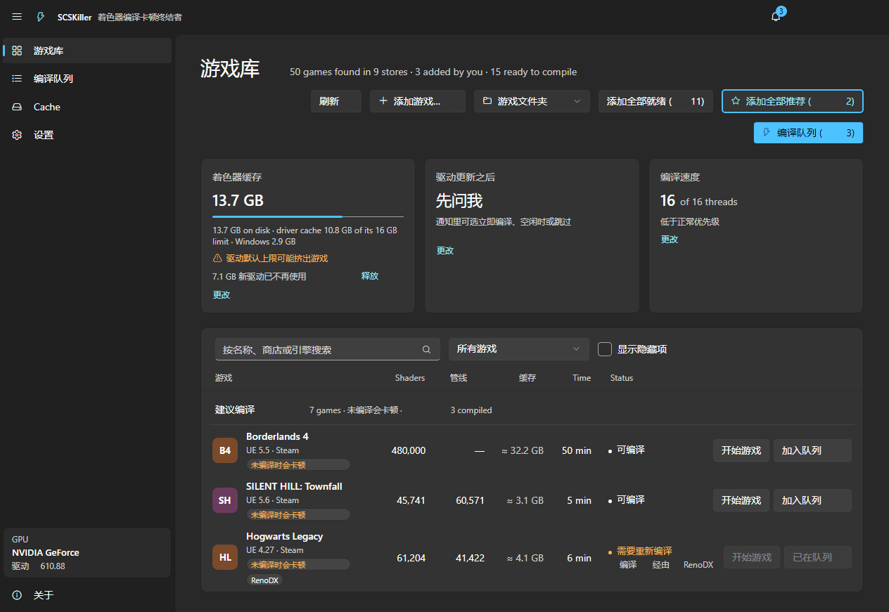
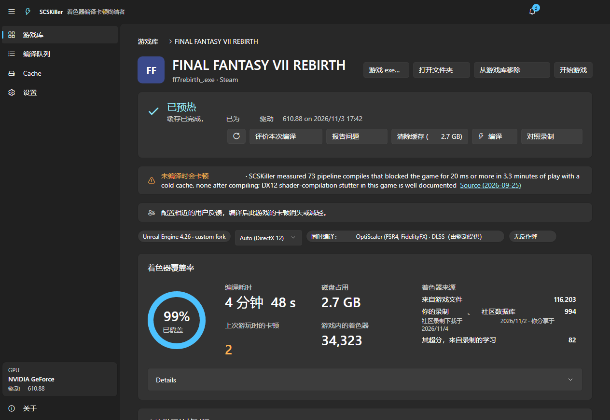
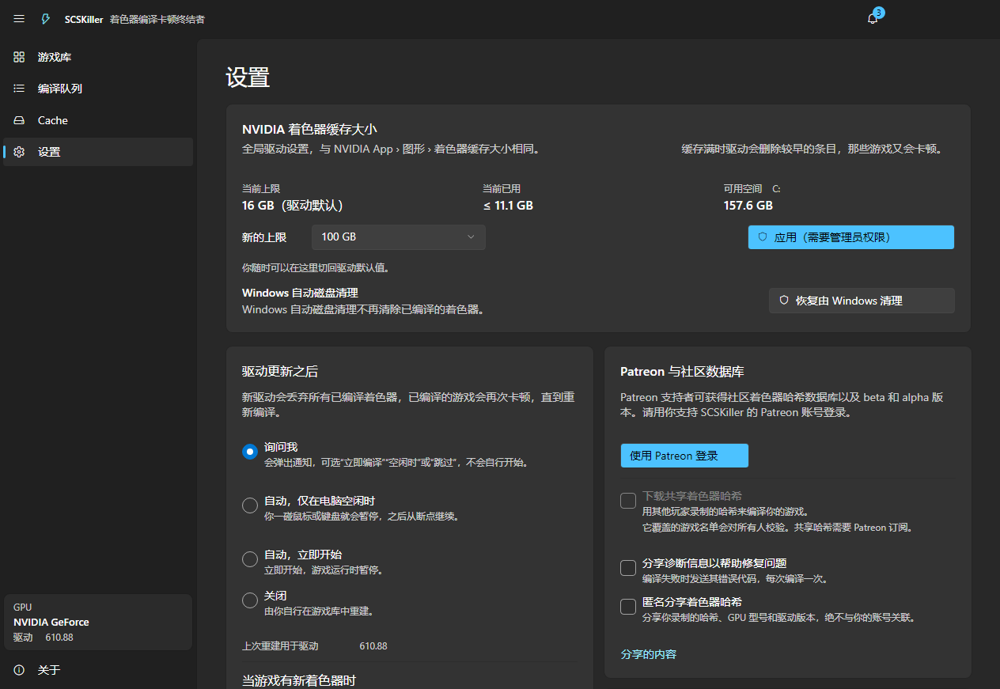
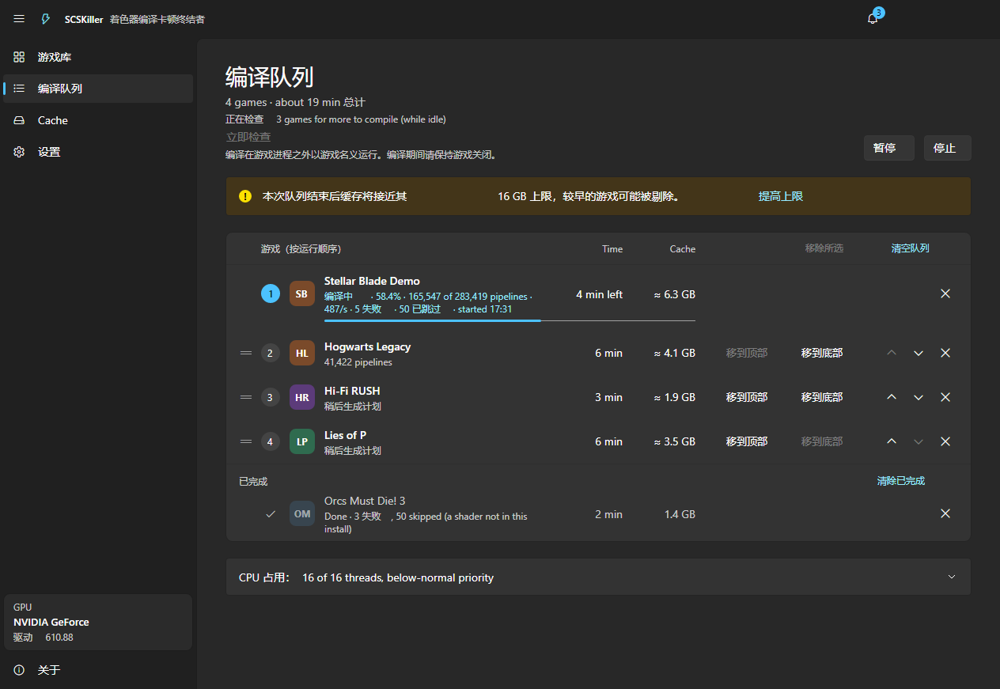
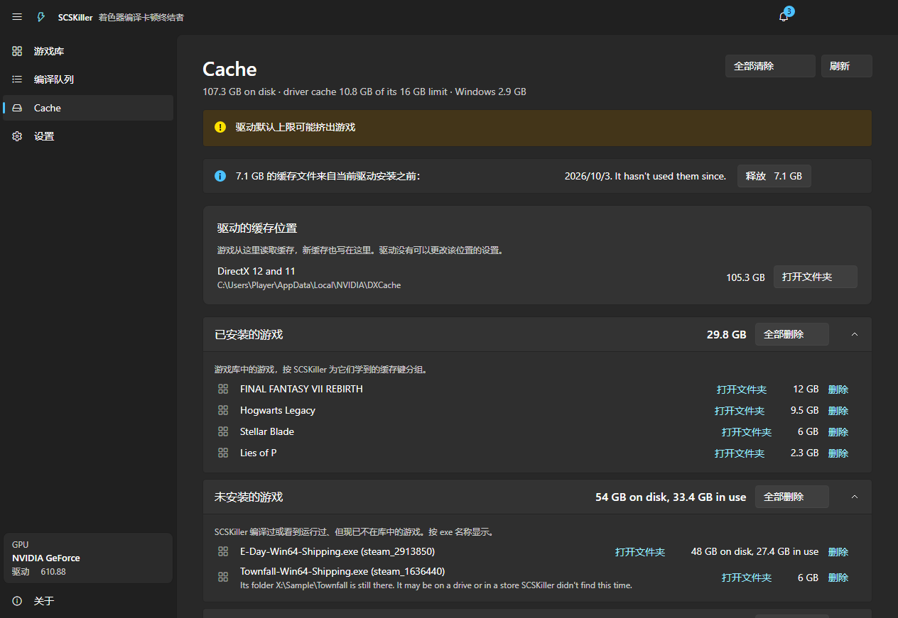

# SCSKiller 汉化补丁（非官方）

把 [SCSKiller](https://github.com/BlueHeisenberg/SCSKiller) 的界面文字替换成简体中文。

**不重新编译原项目，也不改任何逻辑代码**，只把程序集里的字符串原地替换成等长中文，
文件大小、元数据结构、IL 令牌全部不变。

| 项目 | 说明 |
| --- | --- |
| 适用版本 | SCSKiller **1.4.5**（Windows，安装版 / 便携版均可） |
| 汉化规模 | 译表 **1114 条**，实际替换 **1152 处**字符串 |
| 覆盖范围 | 主窗口、游戏库、游戏详情、编译队列、缓存、设置、关于页、各类对话框与提示条 |
| 原项目许可 | GPL-3.0-or-later（本补丁只替换字符串，未修改代码逻辑） |



## 使用方法

### 方式一：一键补丁（推荐）

1. 关掉正在运行的 SCSKiller
2. 下载本仓库（`Code` → `Download ZIP`），解压到**任意位置**（不必放进程序目录）
3. 双击 **`一键汉化.bat`**
   - 脚本会自动查找安装位置（`%LOCALAPPDATA%\SCSKiller\current`、便携版目录等）
   - 找不到时把程序目录作为参数传入：
     `一键汉化.bat "D:\Games\SCSKiller\current"`
4. 重新打开 SCSKiller，界面即为中文

想换回英文：双击 **`还原英文.bat`**（使用打补丁时自动生成的 `*.dll.en.bak` 备份）。

### 方式二：直接覆盖 DLL

把 `已汉化文件` 里的三个文件复制到程序目录，覆盖同名文件：

```
SCSKiller\current\SCSKiller.dll
SCSKiller\current\SCSKiller.Core.dll
SCSKiller\current\SCSKiller.Ui.Models.dll
```

安装版目录一般是 `%LOCALAPPDATA%\SCSKiller\current`；便携版是解压目录下的 `current`。
覆盖前建议先备份这三个文件。

## 界面预览

| 游戏详情 | 设置 |
| --- | --- |
|  |  |

| 编译队列 | 缓存 |
| --- | --- |
|  |  |

## 注意事项

- **程序会自动更新**。更新会把文件换回官方版本，中文随之消失 —— 更新后重跑一次 `一键汉化.bat` 即可。
- 补丁只改 `SCSKiller.dll`、`SCSKiller.Core.dll`、`SCSKiller.Ui.Models.dll` 三个文件，
  大小与结构不变，改完仍是合法的 .NET 程序集。
- 杀毒软件可能对"修改 dll"的行为敏感，被拦截时请放行。
- 想彻底卸载：先 `还原英文.bat`，再按官方方式卸载。

## 1.4.5 说明

1.4.5 新增了「列宽共享组」和更多样式类，界面里有几个词**同时被当作布局标识符**使用。
Avalonia 会校验这些值必须是 ASCII 标识符，填中文会导致程序启动即崩溃，
因此下列位置保持英文（在不改 IL 的前提下无法汉化）：

- 左侧导航的 `Cache`（与游戏库列宽组名共用同一个字符串）
- 游戏库表头的 `Shaders`、`Time`、`Status`
- 详情页的 `Details` 按钮、`Priority` 标签，部分 `Filters` / `Scan` / `Clear` 提示
- 设置里的布局档位词（`Cards` / `Table` / `Narrow` / `Stacked` / `Loose` 等）

此外，1.4.5 的**社区数据库内容**（例如详情页的 `SCSKiller measured 73 pipeline compiles…`）
是运行时从服务器下载的数据文本，不在程序集内，无法汉化。

> 若你此前装的是 1.4.2 汉化版、之后自动更新到 1.4.5，更新器可能因 DLL 被改动而保留旧文件
> （表现为版本号仍显示 1.4.2）。此时请直接覆盖 `已汉化文件` 里的三个 DLL，
> 或用官方安装包重装一次再运行 `一键汉化.bat`。

## 已知不足

- 代码里**运行时拼接**的句子仍是英文，最典型的是游戏库顶部那行
  `46 games found in 8 stores · 14 ready to compile`（按单复数拼接，硬替换会拼出病句，故保留原文）。
- 句子中被插入游戏名/版本号的位置（如 `为什么 XXX 部分编译？`）已按下标翻译，个别语序略生硬。
- 游戏名、引擎名、商店名、显卡/驱动名、Mod 名（DLSS、FSR、ReShade、UE 5.5、Steam 等）保留英文。
- 中文使用系统字体回退渲染（默认微软雅黑），无需额外安装字体。

## 原理

.NET 程序集的用户字符串集中在 PE 元数据的 `#US`（user string）堆里，每条为
`压缩长度前缀 + UTF-16 数据 + 结尾 1 字节`。补丁流程：

1. 解析 PE → CLI 头 → 元数据根 → 定位 `#US` 堆
2. 枚举每条字符串，用 `translations.json` 匹配原文
3. 把中文写回**同一位置**，长度不足处用空格补齐到与原文完全相同的字符数

由于每条字符串的字节长度完全不变，堆偏移、IL 中的 `ldstr` 令牌、元数据流大小都无需改动，
因此不需要重新编译或重新签名。代价是**译文不能比原文长**（中文字符数 ≤ 英文字符数），
中文通常远短于英文，本版 1114 条全部满足；脚本内置检查，超长条目会跳过并提示。

## 已验证

- 用官方 1.4.5 完整包运行程序自带的离屏渲染（`SCSKiller.exe --screenshots`）：
  **585 张**界面截图，退出码 0，无崩溃、无缺页
- 逐字节比对：三个 DLL 的**全部**差异字节均落在 `#US` 堆范围内，堆外 **0** 处改动，
  文件大小不变（1,269,248 / 4,373,504 / 322,560 字节）
- Windows PowerShell 5.1 与 PowerShell 7 下补丁脚本均可运行，
  PS 版与 Python 版生成的 DLL **SHA-256 完全一致**，`-Revert` 可还原到官方原版哈希

## 文件说明

| 文件 | 作用 |
| --- | --- |
| `一键汉化.bat` | 双击打补丁 |
| `还原英文.bat` | 双击还原 |
| `patch.ps1` | 补丁逻辑（PowerShell，无第三方依赖） |
| `translations.json` | 译表：`en` 原文 → `zh` 中文，可自行修改后重跑 |
| `已汉化文件\` | 已打好补丁的三个 DLL（1.4.5），可直接覆盖 |
| `预览\` | 汉化后界面截图 |
| `CHANGELOG.md` | 版本更新记录 |

## 致谢与许可

- 原程序：[BlueHeisenberg/SCSKiller](https://github.com/BlueHeisenberg/SCSKiller)，GPL-3.0-or-later
- 本补丁仅做字符串替换，不修改原程序逻辑；`已汉化文件` 属原程序的衍生二进制，
  同样遵循 GPL-3.0-or-later，源码见上游仓库
- `patch.ps1`、`translations.json` 等脚本与译文采用 [MIT 许可](LICENSE)
